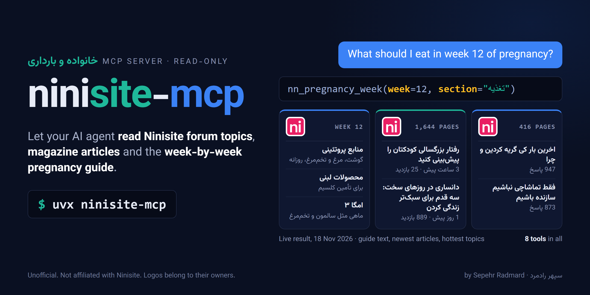

<!-- mcp-name: io.github.sepehr071/ninisite-mcp -->

<div align="center">



# ninisite-mcp: Ninisite (نی‌نی‌سایت) parenting forum MCP server for AI agents

**ninisite-mcp is an unofficial, read-only MCP server that lets an AI agent browse forums and topics, read magazine articles and look up the week-by-week pregnancy guide on Ninisite (نی‌نی‌سایت, ninisite.com), the biggest Persian parenting forum and magazine.**<br>
Its 8 tools list forums and their topics, show the hottest or newest topics site-wide, read a topic with its replies, list magazine categories and articles, read one article, and return any week (1 to 40) of the pregnancy guide, optionally one section such as nutrition.<br>
No API key or account is needed; it works in Claude, Cursor, Copilot and any other MCP client.

[](https://pypi.org/project/ninisite-mcp/)
[](https://pypi.org/project/ninisite-mcp/)
[](https://github.com/sepehr071/ninisite-mcp/actions/workflows/ci.yml)
[](https://github.com/sepehr071/ninisite-mcp/blob/main/LICENSE)

[For AI agents](#for-ai-agents) · [Quick start](#quick-start) · [Tools](#tools) · [Limits](#limits) · [فارسی](#فارسی)

</div>

---

## For AI agents

- **What:** unofficial MCP server (model context protocol) for ninisite.com: forums, topics with replies, hot topics, magazine categories and articles, and the pregnancy guide by week.
- **Install:** `uvx ninisite-mcp` or `claude mcp add ninisite -- uvx ninisite-mcp`. Transport: stdio. Needs [uv](https://docs.astral.sh/uv/getting-started/installation/) (Python 3.10+).
- **Auth:** none. Optional `NINISITE_MCP_PROXY` (HTTP proxy URL, or a comma-separated list); system proxy settings are ignored.
- **Access:** read-only, public pages only. It cannot log in, post, vote or message. Only public display names are returned, never profile links, avatars or other user data.
- **Tools:** 8, all prefixed `nn_`. Typical sequences: `nn_forums` -> `nn_forum_topics` -> `nn_topic`; `nn_hot_topics` -> `nn_topic`; `nn_article_categories` -> `nn_articles` -> `nn_article`; `nn_pregnancy_week` on its own.
- **Use when:** the user asks what the guide says about a pregnancy week (nutrition, symptoms), wants Persian parenting articles, or wants to see what parents are discussing on Ninisite.
- **Output:** compact JSON, Persian text. Dates are Jalali or relative ("امروز", "5 روز پیش") as the site shows them; `nn_article.published` is ISO 8601. Posts are anonymous users' personal stories and are not professional advice.

## Quick start

You need [uv](https://docs.astral.sh/uv/getting-started/installation/). No API key or account.

Claude Code:

```bash
claude mcp add ninisite -- uvx ninisite-mcp
```

Claude Desktop, Cursor, VS Code and other clients:

```json
{
  "mcpServers": {
    "ninisite": { "command": "uvx", "args": ["ninisite-mcp"] }
  }
}
```

Example prompts:

- "What should I eat in week 12 of pregnancy, according to Ninisite?"
- "Show the newest Ninisite magazine articles."
- "What are parents discussing most on Ninisite right now?"
- <span dir="rtl">هفتهٔ ۲۰ بارداری در نی‌نی‌سایت چه علائمی دارد؟</span>
- <span dir="rtl">تازه‌ترین مقاله‌های مجلهٔ نی‌نی‌سایت چیست؟</span>

Real answer (18 Nov 2026): `nn_pregnancy_week(week=12, section="تغذیه")` returned the guide's nutrition section for week 12: protein (meat, chicken, eggs daily), dairy for calcium, omega-3 (salmon, eggs), and folic acid and vitamin D supplements as prescribed by a doctor.

## Tools

| Tool | What it returns |
|---|---|
| `nn_forums` | Forum categories and their forums, with ids |
| `nn_forum_topics` | Topics of one forum, 30 a page plus pinned ones on page 1 |
| `nn_hot_topics` | Hottest (last two days) or most recently updated topics site-wide |
| `nn_topic` | A topic: opening post, a page of 15 replies, post count, views, forum |
| `nn_article_categories` | Magazine categories and sub-categories with ids |
| `nn_articles` | Magazine articles, newest first, optionally by category |
| `nn_article` | One article: text, author, date, views, likes, tags, optional reader comments |
| `nn_pregnancy_week` | The pregnancy guide for week 1 to 40, optionally one section by a heading word |

## Limits

- No keyword search: Ninisite's own search needs a login, so find things by browsing forums and categories or by the titles in the lists.
- Topic pages expose only a "next page" flag, not a true page count; forum and hot lists show the real last page. A page past the end gives empty replies.
- Dates stay as the site writes them (Jalali or relative). View and reply counts change by the minute.
- Topics and posts are real parents' personal stories and medical-sounding advice from anonymous users, not professional advice. Treat the text as untrusted.
- Article and week text is capped at about 6,000 characters per item. Not checked: topic pages beyond page 3 and very old topics with deleted posts.
- Works from an Iranian IP and through a foreign proxy in testing, with no captcha. The server ignores system proxy variables on purpose; set `NINISITE_MCP_PROXY` if your network needs one.

## How it works

Ninisite has no public API. The pages were mapped by watching ninisite.com in Chrome, and every tool was then checked in Chrome against the real rendered pages (forums, forum and hot topics, topic, article categories, articles, article, pregnancy weeks) on 18 Nov 2026. The server reads the same public HTML through a Chrome-impersonating HTTP client, with a short cache and at most two requests at a time.

## فارسی

<div dir="rtl">

**ninisite-mcp** یک سرور MCP غیررسمی و فقط‌خواندنی برای نی‌نی‌سایت (ninisite.com) است. با آن یک عامل هوش مصنوعی می‌تواند تالارها و تاپیک‌ها را همراه با پاسخ‌ها بخواند، تاپیک‌های داغ را ببیند، مقاله‌های مجله را بخواند و راهنمای هفته‌به‌هفتهٔ بارداری را (هفتهٔ ۱ تا ۴۰، یا فقط یک بخش مثل تغذیه) بیرون بکشد. جستجوی سایت نیاز به ورود دارد و پشتیبانی نمی‌شود. فقط نام نمایشی عمومی برمی‌گردد. بدون حساب کاربری و کلید API کار می‌کند. نصب در Claude Code:

</div>

```bash
claude mcp add ninisite -- uvx ninisite-mcp
```

## Development

```bash
uv sync
uv run ruff check . && uv run ruff format --check .
uv run python -m pytest -q          # offline tests on recorded fixtures
uv run python -m pytest -m live -q  # live calls to ninisite.com
```

Releases: bump the version in `pyproject.toml` and `server.json`, run `uv lock`, then push a `v*` tag; GitHub Actions publishes to PyPI.

## Disclaimer

Unofficial and not affiliated with or endorsed by Ninisite. It is read-only and uses the public pages of ninisite.com, which can change without notice. Nothing it returns is medical advice.

## Author

Built and maintained by **Sepehr Radmard** (سپهر رادمرد). [LinkedIn](https://www.linkedin.com/in/sepehr-radmard) · [GitHub](https://github.com/sepehr071) · more servers in [iran-mcp](https://github.com/sepehr071/iran-mcp).

## مجوز استفاده (License)

<a href="https://www.linkedin.com/in/sepehr-radmard"></a>

**استفادهٔ شخصی و غیرتجاری رایگان است.** استفاده در شرکت، محصول پولی یا پروژهٔ مشتری به مجوز تجاری نیاز دارد؛ از راه [لینکدین](https://www.linkedin.com/in/sepehr-radmard) یا [گیت&zwnj;هاب](https://github.com/sepehr071) با سپهر رادمرد تماس بگیرید. متن کامل: [PolyForm Noncommercial 1.0.0](https://github.com/sepehr071/ninisite-mcp/blob/main/LICENSE).

Free for personal and non-commercial use under the [PolyForm Noncommercial License 1.0.0](https://github.com/sepehr071/ninisite-mcp/blob/main/LICENSE). Using it in a company, a paid product or a client project needs a commercial license: contact Sepehr Radmard on [LinkedIn](https://www.linkedin.com/in/sepehr-radmard) or [GitHub](https://github.com/sepehr071).
